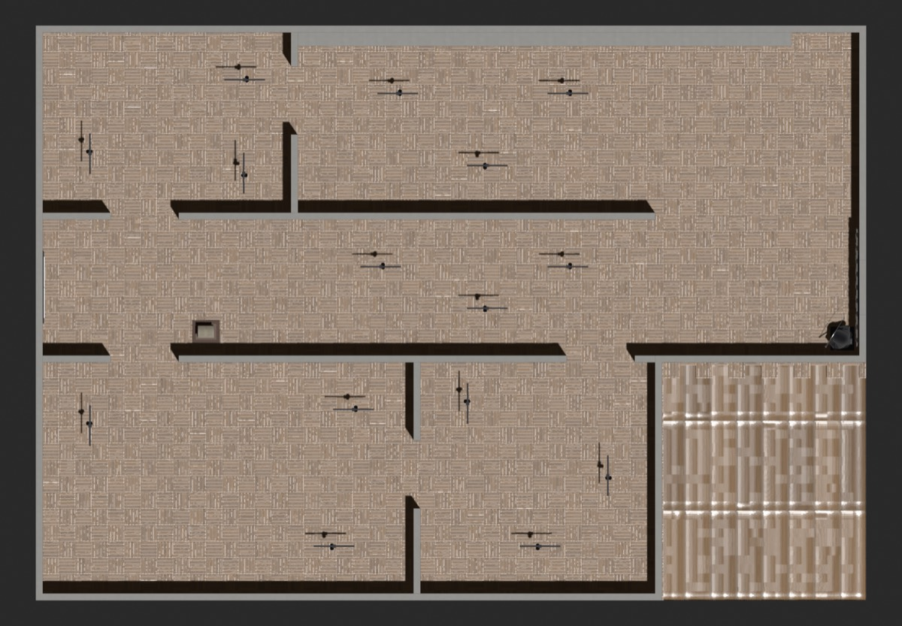
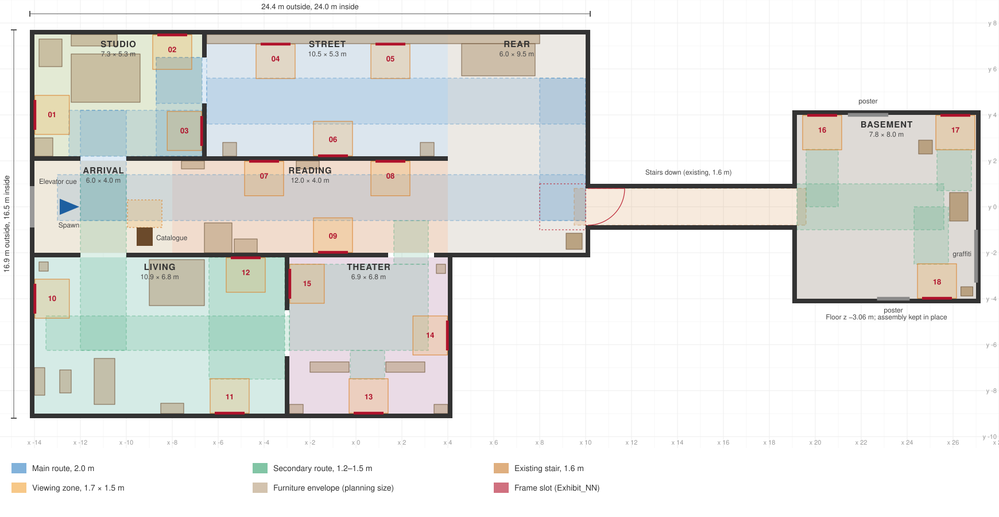

# Exhibition design

## Main gallery

The gallery follows the accepted redesign plan below (#86), built as an undecorated shell in #87. It replaced the original 20 × 10 m blockout with recessed bays, two freestanding islands and a central lectern; that history stays in git and `docs/ROADMAP.md`. Keep the routes, viewing zones and the basement approach clear.

The shell is 24.0 × 16.5 m inside with the south-east corner cut away and a 3.6 m ceiling. Full-height partitions divide it into the catalogue end of the central band, studio, street, reading area, living room, theater and rear landing, as planned. A 0.4 m furring wall along the street's north wall stands in for the facades #95 will dress. The catalogue lectern stands beside the arrival axis with its reader on the north side. The visitor arrives in an enclosed elevator car behind the studio's west wall, 2.0 × 2.0 m inside with a 2.6 m lit ceiling, facing east through its doors into the studio. The 1.6 × 2.4 m basement doorway opens east from the rear landing into the stairwell. When the walk starts the car's two steel leaves slide 0.9 m apart into the wall over 1.8 s, after a 0.6 s beat, and stay open; with reduced motion they are simply open. `COL_Elevator_Doors` keeps the visitor in the car until the gap is half open. Each display has a test frame with a red top-left mark and its own track spot light. `assets-source/blender/gallery_blockout.py` builds the walls, partitions, spawn, lectern placement and anchors from `assets-source/layout/redesign.json`, so the plan and the export cannot drift apart. The studio is furnished (#91) as the reference room for the others:

- original bamboo panelling on its walls, drawn by `gallery_finishes.bamboo_finish`;
- warmer spotlights (about 2700 K) on its three frames;
- the drafting table as its worktable, against the north wall;
- the easel east of it, its canvas facing the room;
- the watercolours on an original supply cabinet in the north-west corner;
- the horse statue in the corner beside the elevator.

Its props are one vertex-coloured draw. The furniture envelopes for the other rooms wait for #92–#95.

Reserve exactly eighteen anchors, `Exhibit_01` through `Exhibit_18`, three per section. Slot 01 is the Doraemon academic essay, published with its rights record in `public/essays/CREDITS.md`. Slots 02–18 are initially placeholders with neutral titles. Anchors 01–15 hang at the plan's upstairs slots in `gallery.glb`, three per section in walking order. Anchors 16–18 export with `basement.glb` and are hung only when the basement first loads (#88), so the initial load requests no basement geometry or artwork. All 18 appear in the accessible directory either way. Validate that every display can be approached and read. Materials, lighting style, and palette require approval before final modeling. The preview uses temporary colors.

## Visitor experience

Use a restrained crosshair and a contextual prompt in first-person mode. Provide an opening screen that explains WASD, mouse look, click and E, and Escape. Looking at a display within three meters shows its title and description. Opening a display reveals its title, description, and an essay action when a PDF is available. Exiting the viewer restores focus and leaves the player in place. The opening screen and pause menu share one overlay: a heading that changes from Explore the exhibition to Paused, the controls list, Start walk or Resume walk, and a Settings disclosure. Settings hold look sensitivity and a Graphics group, saved per visitor in local storage. Resolution scales the capped device pixel ratio from 50% to 100%, and Display spotlights turns the fifteen gallery spotlights on or off. Both apply immediately. No visual effects are approved yet, so none are implemented. When pointer capture is refused or unsupported, as Firefox does for keyboard activation, the walk starts anyway and the arrow keys look around, so the tour works from the keyboard alone. A conventional keyboard-accessible 2D directory will provide direct access to content without first-person navigation.

## Basement of Doom

A metal-band-inspired “BASEMENT OF DOOM” sign and a Grim Reaper statue mark the entrance. The blockout builds both from primitives in `gallery_blockout.py`: a spiked iron board with raised Blender-font lettering, and a hooded figure with a scythe on a plinth beside the doorway. Final lettering and statue styling still need art direction approval. The door in the rear landing's east wall opens onto stairs descending east. The rendering treatment will contrast the modern academic gallery with weathered concrete, deteriorated plaster, and atmospheric light.

The room draws on the Helvete record shop basement. Its planned elements include handwritten “BLACK METAL” graffiti, a wooden throne, a metal candle stand, and a bare overhead bulb. The blockout builds all of them from primitives and sheared Blender-font lettering: a weathered concrete and plaster room with exposed brick and floor stains, the graffiti above a high-backed throne on the east wall, a five-candle iron stand, and bare bulbs over the room and the stairs. Point lights at each bulb and the candles carry the light, and gallery daylight fades below ground. Every basement mesh, letter, and colour is original, so there are no external asset rights to record. Create original meshes, lettering, and texture work and review attribution and permissions for any external assets. Environmental audio is optional. Keep the entrance and staircase outside the primary academic route and fetch basement-specific assets only when needed.

## Exhibition redesign plan (accepted)

This section is the measured plan for issue #86. The owner accepted the layout as drawn on 2026-11-26, including the five decisions below, and revised it the same day: the arrival elevator opens into the studio and the basement door opens from the east wall of the rear landing. #87 built the shell and the fifteen upstairs slots from it; #88 adds the basement slots and section-aware loading. The machine-readable plan is `assets-source/layout/redesign.json`. `tests/unit/layout-plan.test.ts` checks it, and `node assets-source/layout/plan_svg.mjs docs/renders/layout/redesign-plan.svg` redraws the [plan diagram](renders/layout/redesign-plan.svg).

### Sources and what is measured

The Canva board (audited 2026-11-26) fixes only relative placement: studio near arrival, street farther along the left side, reading area in the middle, living room front right, theater rear right, basement at the rear. Its grid and perspective views are not measurements, and every dimension below is a design decision made here. The furniture envelopes are planning sizes for typical furniture, not the bounds of the linked models. #90 measures the real models; any model larger than its envelope is scaled, swapped, or the section is re-checked with the same test.

### Coordinates

Blender metres, +X east toward the basement, +Y north, +Z up; three.js positions are (x, z, −y). Plan rectangles are written `[x0, x1, y0, y1]`. A frame's gaze is the direction a visitor looks to see it, as in `marker()` in `gallery_blockout.py`, so a frame on a north wall has gaze N.

The basement entrance, sign, statue, stairwell, and room use the authored orientation in `basement_transform`. The door opens east at x = 10, centered on y = 0. The stairs lead to a room at x 19 to 27, outside the upstairs footprint. The hinge starts with zero local rotation, and the radio reads its emitter's world position at runtime.

### Footprint and sections

The upstairs interior is 24.0 × 16.5 m (x −14 to 10, y −9 to 7.5), with a 6.0 × 7.0 m notch cut from the south-east corner (x 4 to 10, y −9 to −2). The ceiling stays at 3.6 m with wood floors and a white ceiling. Outer walls and partitions are 0.2 m thick and full height. The current hall is 20 × 10 m, so this is about 1.8 times its floor area (354 m² against 200 m²).

A full-length spine at y = 2 and a parallel partition at y = −2 make a 4 m central band: the catalogue at its west end, the reading area in its middle (open at both ends), and the rear landing at its east end, where the basement door opens east and a double door connects to the street on the north side. The studio and street sit north of the spine, and the living room and theater south of the partition. The elevator car opens into the studio's west wall.

| Section      | Plan rectangle                                                  | Size         | Furniture envelopes                                                                                                                                                  |
| ------------ | --------------------------------------------------------------- | ------------ | -------------------------------------------------------------------------------------------------------------------------------------------------------------------- |
| Elevator     | x −16.2 to −14.2, y 3.05 to 5.05, behind the studio's west wall | 2.0 × 2.0 m  | Handrail; 1.8 m sliding doors; lit ceiling at 2.6 m                                                                                                                  |
| Catalogue    | x −14 to −8, y −2 to 2                                          | 6.0 × 4.0 m  | Catalogue lectern 0.8 × 0.7 m, reader on its north side                                                                                                              |
| Studio       | x −14 to −6.7, y 2.2 to 7.5                                     | 7.3 × 5.3 m  | Worktable 3.0 × 2.1 m (1.8 × 0.9 m table with 0.6 m working space), easel 1.0 × 0.8 m, statue 0.8 × 0.8 m, supply shelf 1.2 × 0.5 m; elevator doors in the west wall |
| Street       | x −6.5 to 10, y 2.2 to 7.5                                      | 16.5 × 5.3 m | Facades 0.4 m deep along the north wall, two planters 0.6 × 0.6 m, jeepney 3.2 × 1.4 m where the street meets the rear landing                                       |
| Reading      | x −8 to 4, y −2 to 2                                            | 12.0 × 4.0 m | Two bookshelves 1.0 × 0.35 m, desk with chair 1.2 × 1.3 m, scrolls 1.0 × 0.6 m                                                                                       |
| Living       | x −14 to −3.1, y −9 to −2.2                                     | 10.9 × 6.8 m | Couch 0.9 × 2.0 m, small table 0.5 × 1.0 m, TV 0.45 × 1.2 m, display case 1.0 × 0.45 m, dining set 2.4 × 2.0 m, vase                                                 |
| Theater      | x −2.9 to 4, y −9 to −2.2                                       | 6.9 × 6.8 m  | Two benches 1.7 × 0.45 m, two castle wall pieces 0.6 × 0.4 m, vase                                                                                                   |
| Rear landing | x 4 to 10, y −2 to 2                                            | 6.0 × 4.0 m  | Statue south of the basement door. The approach at x 8 to 10, y −0.8 to 0.8 stays clear.                                                                             |
| Basement     | x 19 to 27, y −4 to 4, floor z −3.06                            | 8.0 × 8.0 m  | Throne, candle stand and radio table                                                                                                                                 |

The studio worktable and living-room furniture were placed first. The section sizes follow from them, the frame viewing zones, and the routes.

### Arrival and circulation

The visitor arrives inside the elevator car at (−15.5, 4.05), facing east through its doors into the studio, with the Doraemon frame (Exhibit_01) on the partition straight ahead. The doors slide open when the walk starts; the elevator does not travel. The studio door (2.0 m) to the central band is on the right, and the catalogue lectern stands on the band's south side with a 1.5 × 1.2 m approach on its north side.

The routes are the testable targets from the brief, not code or legal claims: 2.0 m main routes, 1.2–1.5 m secondary routes, and a 1.7 × 1.5 m clear viewing zone in front of each frame. Two loops start and end at arrival:

- North loop (main, 2.0 m): elevator → studio → street → rear landing → reading area → catalogue → studio door → elevator.
- South loop (secondary, 1.5 m): catalogue → living room → theater → theater door → reading area → catalogue.

The basement branches east off the rear landing through the existing 1.6 m door and stairwell. Both are narrower than the main-route target and are kept as built. The door swings outward into the stairwell, so nothing on the gallery side is in its sweep. Routes may cross viewing zones, but never a wall or a furniture envelope.

### Frame slots

Eighteen slots, three per section, are numbered in walking order. Frames are the existing 1.3 × 1.0 m frame, centred 1.5 m above the floor and 0.02 m off the wall face. The two historical basement posters are decoration, not slots.

| Slot       | Section  | x      | y     | Wall                             | Gaze |
| ---------- | -------- | ------ | ----- | -------------------------------- | ---- |
| Exhibit_01 | studio   | −6.72  | 3.30  | studio/street partition          | E    |
| Exhibit_02 | studio   | −8.00  | 7.48  | north wall                       | N    |
| Exhibit_03 | studio   | −13.98 | 6.10  | west wall, north of the elevator | W    |
| Exhibit_04 | street   | −3.50  | 7.08  | facade face                      | N    |
| Exhibit_05 | street   | 1.50   | 7.08  | facade face                      | N    |
| Exhibit_06 | street   | −1.00  | 2.22  | spine, north face                | S    |
| Exhibit_07 | reading  | −4.00  | 1.98  | spine, south face                | N    |
| Exhibit_08 | reading  | 1.50   | 1.98  | spine, south face                | N    |
| Exhibit_09 | reading  | −1.00  | −1.98 | south partition, north face      | S    |
| Exhibit_10 | living   | −13.98 | −4.00 | west wall                        | W    |
| Exhibit_11 | living   | −5.50  | −8.98 | south wall                       | S    |
| Exhibit_12 | living   | −4.80  | −2.22 | south partition, south face      | N    |
| Exhibit_13 | theater  | 0.55   | −8.98 | south wall                       | S    |
| Exhibit_14 | theater  | 3.98   | −5.60 | notch wall                       | E    |
| Exhibit_15 | theater  | −2.88  | −3.35 | living/theater partition         | W    |
| Exhibit_16 | basement | 20.30  | 3.98  | north wall                       | N    |
| Exhibit_17 | basement | 26.10  | 3.98  | north wall                       | N    |
| Exhibit_18 | basement | 25.30  | −3.98 | south wall                       | S    |

Basement frames sit at z −1.56 (1.5 m above the basement floor). Their 2.8 m ceiling leaves 0.8 m above each frame. Exhibit_16 and Exhibit_17 flank the Kittelsen print on the room's north wall, and Exhibit_18 sits between the Doré print and the radio on its south wall. None blocks the stairs, throne, graffiti, radio or candle stand.

### Content mapping

Content stays bound to slot IDs, so nothing is lost when frames move. Exhibit_01 keeps the published Doraemon artwork and essay PDF and hangs on the studio partition facing the elevator, the first frame seen when its doors open. Exhibit_03 takes the studio's west wall, north of the elevator. Exhibit_02–15 keep their placeholder entries and move to the positions above. Exhibit_16–18 are basement placeholders; the manifest has 18 entries, and `src/exhibition/manifest.ts` records each slot's section (a unit test keeps it in step with the plan). Directory entries keep neutral names; section names stay out of artwork titles.

### Decisions

Accepted with the layout on 2026-11-26. The far plane, jeepney and partition-height items are checks for the issues named, not open layout questions.

- **Arrival.** The board sketches the elevator at the front-left corner. The first build put it at the west end of the central band; the owner's revision moved it into the studio's west wall, matching the board. Arriving in the studio puts its worktable just north-east of the doors; the exit route from the car stays clear of every studio envelope, and the easel and supply shelf moved to the north wall to keep the west wall's frame viewable.
- **Doraemon placement.** Exhibit_01 hangs where the elevator doors open onto the studio. The essay's subject also fits the living room; swapping two manifest entries in #88 moves it without changing geometry.
- **Theater partitions.** The board shows two short freestanding partitions. The plan hangs all three theater frames on the perimeter and uses low castle wall pieces instead, which keeps the 6.9 m room open for benches. Freestanding wings remain possible in #94 if they stay out of the routes and viewing zones.
- **Jeepney size.** A real jeepney is about 6–7 m long. The 3.2 × 1.4 m envelope assumes a shortened or scaled model; #95 decides which.
- **Full-height partitions.** Partitions reach the ceiling to keep lighting and occlusion simple. #87 may lower them if sightlines need it.
- **Far plane.** The longest sightlines are about 26 m: from the elevator through the studio and street to the east wall, and from the rear landing down the stairs to the basement's far wall. The 40 m camera far plane covers them.
- **Basement access width.** The existing 1.6 m door and stairwell stay below the 2 m main-route target.
